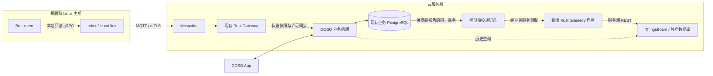

# 遥测平台构建与现有项目迁移

更新：2026-11-09。首批Rust程序、业务增量SQL与服务接口已实现；测试业务ECS已发布历史/投递接口和SQL，App已有日期轨迹入口。历史平台仍使用本机隔离ThingsBoard经SSH私有通道接入，尚未形成独立于开发机的常驻部署。新增界面、职责和部署边界见 [TRACKS.md](TRACKS.md)，候选及许可依据见 [REUSE.md](REUSE.md)，运行证据见 [TESTING.md](../TESTING.md)。

## 交付目标

第一项交付是一台机器狗在客户明确的数据范围与部署选择下，能够查询带原始时间的状态历史，供客户授权成员查看。此前内部看板验证仅使用模拟数据，不表示DOSO员工默认可以查看客户业务。客户继续使用DOSO App；Rust SDK、本地运动控制、设备绑定和云连接许可继续由现有实现负责。人员可见性、业务告警与售后边界统一见 [客户数据与告警责任](../CONTRACT.md#客户数据与告警责任)。

采用顺序：先验证 ThingsBoard 的历史与看板，再在 DOSO App 增加历史入口，最后依据实际替代关系删除多余实现。首轮不同时引入 Ditto、OpenRemote 或新 MQTT broker。MCAP/Foxglove 是独立的传感器记录工具，不作为云平台迁移的前置条件。

## 现有实现决定的边界

1. [Gateway 同步](../cloud/gateway/src/sync.rs) 每两秒发送 latest 快照；机端最多 1 Hz 读取，但同步期间的中间状态可能被覆盖。首版保存的是“业务接受的快照历史”，不承诺逐秒全量记录。提高轮询频率也不等于可靠保存所有报告。
2. [业务状态表与事务](<C:/Users/99563/Documents/ChatGPT/New project/doso-app/supabase/migrations/20261103150000_add_remote_state.sql>) 中，`private.device_remote_state` 一设备一行，保存 latest 和 last_success。`public.sync_remote_state()` 在归属、许可、会话、序号、时间检查通过后才接受新快照；HTTP 200 只返回许可，不能证明每条上送报告都被接受。
3. 当前状态 `observedAt` 是机端本次 gRPC 读取完成时间，`receivedAt` 是 Gateway 接收时间；不能把导入时间写成原始观察时间，也不能宣称已有硬件采样绝对时间。
4. [App 当前接口](<C:/Users/99563/Documents/ChatGPT/New project/doso-app/src/services/remoteState.ts>) 已支持用户选择、设备执行、新鲜度、最近结果与最后成功值。保留这一合同可以逐步接新平台而不用同步重发全部客户端。
5. [此前的业务环境决定](<C:/Users/99563/Documents/ChatGPT/New project/doso-app/docs/production/DOSO_BACKEND_DEPLOYMENT.md>) 是保留旧 Supabase 环境、不迁旧账号或业务数据。本方案只扩展现用 DOSO 业务链，不恢复执行已取消的旧账号迁移。
6. 本次复核时共享工作区正在并行增加可选 `location`，涉及 `shared/src/status.rs`、机端读取、App 类型与 [位置校验迁移](<C:/Users/99563/Documents/ChatGPT/New project/doso-app/supabase/migrations/20261108010000_add_remote_location.sql>)。实施时以最新迁移链和源码为基线，保留新字段；本方案不将其视为已部署或真机定位验收。

## 目标部署与数据归属

虚线表示新增的遥测分支；App历史查询已实现。各部分不代表全部已经常驻云端部署或真机上线。



下表描述技术组件持有什么状态，不表示DOSO取得客户业务数据的自由查看或使用权限。

| 数据或能力 | 技术状态持有方 | 迁移方式 |
| --- | --- | --- |
| 账号、会话、设备 UUID、机主、认领码、授权 | 现有 DOSO 业务后端与数据库 | 原地保留，第三方平台不接管用户认领 |
| 当前选择、许可、设备确认、latest/last_success | 现有状态事务与 App API | 原地保留，先保证兼容和可回退 |
| 消息验签、MQTT 会话、设备链路 | robot-cloud 的现有 Rust 程序 | 原地保留，不把原始签名信封直接交给 ThingsBoard |
| 客户历史快照、曲线和看板 | 新增 ThingsBoard 投影 | 按客户授权范围和所选部署环境保存；它不反向决定用户权限或机端动作 |
| 第三方设备映射、短期投递进度 | 现有业务数据库的私有表 | 保存投递所需事实，不再建一套账号或永久历史库 |
| 本地 100 Hz IMU/关节、点云 | Brainstem/LingTu 与 SDK 现有观测接口 | 按需要通过 MCAP 记录，不默认全量上云 |
| 视频 | 现有 MediaMTX/WebRTC 候选 | 沿现有独立媒体流程推进 |

ThingsBoard 自身也维护 latest，供其内部看板使用；DOSO App 的实时状态继续读现有业务 API。两者用途明确，不互相同步覆盖。

## 最少需要新增的代码

以下实施落点已创建Rust程序和业务SQL/服务接口，App历史查询与展示留待后续批次。保留现有目录，新增文件各自承担实际职责。

```text
D:\DOSO\robot-cloud\
  cloud/telemetry/           新增：云端 Rust 投递程序和 ThingsBoard 部署说明
    src/main.rs             进程配置、启动与停止
    src/export.rs           领取已授权记录、投递、确认与有限重试
    src/thingsboard.rs      固定平台的设备/属性/遥测 API 与字段映射
    src/http.rs             共用HTTP可信边界、超时和消息大小限制
  Cargo.toml                增加一个 workspace 成员

现有 doso-app 项目
  supabase/migrations/      新增增量 SQL：私有映射、待投递表及相关函数
  supabase/functions/
    telemetry-export/       新增可信服务入口：领取、确认，复用既有服务鉴权
  src/services/             后续增加历史查询；现有 remoteState 保持
  src/components/           后续增加历史入口；现有实时状态面板保持
```

SQL使用新增 `20261108020000_add_telemetry_export.sql`，不编辑已发布迁移。实际实现用 `private.device_remote_state` 的更新触发器，在 `latest/last_seq` 接受新报告后同事务入队，避免复制整个 `sync_remote_state()` 函数。不能在Edge收到SQL成功后复制整个原始请求，因为其中可能包含已被跳过的旧报告。

待投递记录保存完整的已接受原报告及接收时间、当时归属，平台适配再选择看板字段；不按首轮四类字段重新拼装原报告，避免丢掉并行新增的有效数据。

上述完整报告保留是当前实验实现。客户数据责任明确后，正式接入必须先在采集/上传边界按客户允许的类别和用途形成报告，再保留授权后的内容；不能用“原样保真”解释为无条件上传所有字段。当前位置和sourceReport的细分许可、人员查看隔离尚未实现。

首轮不改机端 `robot/`、Gateway 的 MQTT 与同步协议、`shared/` 状态格式，也不新建 Python IoT Gateway。Rust 程序复用工程已用的 Tokio、Reqwest、Serde，不设计通用平台插件或抽象驱动框架。

待投递表只解决一个问题：数据库接受报告后，ThingsBoard 网络超时或进程重启仍能重试。外部 HTTP 在事务外执行，避免等待平台响应拖慢许可续期。现有 PostgreSQL 自身写失败仍可能影响原同步事务，不能承诺任意故障都被隔离。

## 设备映射、字段与投递规则

**设备 ID：** DOSO UUID v4 保持不变，ThingsBoard 新建设备生成自己的内部 UUID，二者由服务端映射。为了隔离授权期间，首版映射键采用 `(device_id, authorization_epoch)`，接受时同时保存 `owner_id`；ThingsBoard 内部名称可用 `doso:<uuid>:<epoch>` 恢复重复创建。epoch 是现有授权字段，不增加面向客户的机器人版本或编号。

Epoch 不等于机主编号：同一机主的安全状态变化也可能推进 epoch。后续 App 历史查询先检查当前机主，再限制到当前授权期间的映射；同机主跨授权期间的历史，等有产品需求再扩展。不能只按机器 UUID 查询所有历史后交给新机主。

**字段：** 原始数据继续由 `shared` 拥有。第三方映射复制已有枚举字符串，不维护另一套枚举含义。

| 已有事实 | ThingsBoard 投影建议 | 规则 |
| --- | --- | --- |
| `report.observedAt` | 遥测 `ts`，UTC Unix 毫秒 | 保留机端观察时间，不能改为导入时间 |
| `receivedAt`、connection/session、seq、epoch/version | 遥测来源字段与投递身份 | 接受时固化，重试不改写 |
| `status.state.kind/transition` | `stateKind/stateTransition` | 原样复制现有合法字符串 |
| `status.control.owner` | `controlOwner` | 不把 GRPC/YUNZHUO 等来源擅自改成 Builtin/External 运控模式 |
| 电机使能、严重电机故障 | `motorOutputEnabled/criticalMotorFault` | 原样复制布尔值 |
| 成功或 `error` | `sampleOk/readError` | 失败点不复制上次成功值冒充新读数；成功点显式清除旧错误标记 |
| 机器人 ID、机器人版本、固件版本 | 服务端属性 | 仅使用登记/发布真源已有值，缺少就不填，保留既定三项产品标识 |

首轮看板先映射四类核心状态；可选位置保留在原报告中，映射与实测另验。不从旧演示电量或 UI 默认值生成新遥测。内部看板同时显示 `sampleOk` 和原始时间，不能把 ThingsBoard 接口被调用的时间当作机器狗在线证据。

**一致性：** 待投递身份使用设备、epoch、许可版本、session 和 seq；重复接受不重复入队，重试发送同一份时间和值。领取采用有期限的处理标记，成功后确认；服务重启可恢复未确认记录。试验仅启用指定设备，批量与积压有界，达到边界显式报告缺口，不能静默当作完整历史。长期历史留在平台，已投递记录按短期策略清理。

重试核对固化的 owner、epoch、consentVersion 与当前归属、用户选择和账号有效性；不要求原始采集 session 的三十秒租约仍有效。报告已经被业务接受，普通租期轮换或会话重连不应抹掉其历史资格；真正撤权、关闭或归属变化仍取消待发送。

ThingsBoard PostgreSQL 按 `(entity_id, key, ts)` 冲突更新，不按 DOSO 的 seq 去重。同一 key、同一毫秒的不同报告可能覆盖；首轮需检测并展示此类冲突，不通过修改源时间伪造顺序。此方案用于低频状态看板，完整事件账本和高频传感器留给各自合适的存储。

**关闭和归属变化：** 关闭后停止新记录入队，取消未发送记录，重试前重验当前归属/epoch/许可。已经开始的外部 HTTP 无法与本地撤权事务原子取消，可能完成撤权前已接受的数据投递；状态说明须区别停止新采集、待投递取消与在途请求完成。这里不扩展为历史删除功能，也不把它作为机端“完全断云”已经实现的证据。

## ThingsBoard 如何构建与连接

非生产试验固定 **4.3.1.8**，使用 [官方 CE Docker 示例](https://thingsboard.io/docs/installation/docker/) 的 TB 节点与独立 PostgreSQL；这是有明确启动范式的 Apache-2.0 评估基线。其安全支持到 2027-07-20，不把该选择直接当长期生产版本。正式采用前对 4.4+ 的升级、费用及品牌条款作出选择；4.4.0.2 镜像无激活 key 的具体启动能力本次未运行验证。

构建步骤：

1. 在独立开发环境固定镜像版本和摘要，使用独立 Compose 项目名、数据库、卷与网络；不连接现有业务 PostgreSQL，不复用生产凭据。
2. 首轮只需本机 HTTP 管理/API 端口；数据库不映射宿主机端口，TB MQTT/CoAP 不对外开放。正式服务端之间跨主机连接使用 HTTPS。
3. 建专用 TB 技术账号，API key 仅交给投递程序；首轮内部租户隔离测试设备。API key 继承账号权限，不能误认为天然只写遥测的窄权限凭据。
4. 创建一台指定设备的映射，经以下 REST 接口写属性和历史；再读回核对设备、时间、字段和重试行为。
5. 构建 Rust 投递程序，应用经过测试的新 SQL 和服务接口，先启用指定的一台设备。平台不可用时当前 App、许可续期和关闭流程仍按原链路运行。

内部投递入口默认关闭，复用设备映射记录逐设备启用，不增加客户设置。发布顺序固定为“新增表/函数且出口关闭 → 服务接口 → Rust 程序 → 开启指定设备出口”。回退先关闭入队与新领取，再停止投递进程；保留原始状态表和已有历史，不以删表或回滚设备归属实现回退。

固定版本已核验的 API：

```text
POST /api/device
GET  /api/tenant/device?deviceName=<内部名称>
POST /api/plugins/telemetry/DEVICE/{tb_device_id}/attributes/SERVER_SCOPE
POST /api/plugins/telemetry/DEVICE/{tb_device_id}/timeseries/ANY
Header: X-Authorization: ApiKey <服务端凭据>
```

依据：[TelemetryController](https://github.com/thingsboard/thingsboard/blob/v4.3.1.8/application/src/main/java/org/thingsboard/server/controller/TelemetryController.java)、[DeviceController](https://github.com/thingsboard/thingsboard/blob/v4.3.1.8/application/src/main/java/org/thingsboard/server/controller/DeviceController.java)、[API key 鉴权](https://github.com/thingsboard/thingsboard/blob/v4.3.1.8/application/src/main/java/org/thingsboard/server/service/security/auth/pat/ApiKeyAuthenticationProvider.java)。`ANY` 不是租户隔离域；接口同时保存历史与平台 latest，保持默认 `sql.ts_latest.update_by_latest_ts=true`，旧时间不覆盖较新值，同时间仍可能覆盖。[存储实现](https://github.com/thingsboard/thingsboard/blob/v4.3.1.8/dao/src/main/java/org/thingsboard/server/dao/sqlts/insert/latest/sql/SqlLatestInsertTsRepository.java)

该 REST 写入直接进入遥测保存服务，不能据此承诺原生设备在线状态或完整告警规则链已经接通。首轮验收历史和看板；告警若进入下一项交付，先验证适用的规则引擎入口，再决定接法，不重复造告警系统。[保存路径](https://github.com/thingsboard/thingsboard/blob/v4.3.1.8/application/src/main/java/org/thingsboard/server/service/telemetry/DefaultTelemetrySubscriptionService.java)

规划时Docker Engine不可连接；实施阶段已启动本机Docker，拉取并核对固定摘要，运行独立TB/PG、完成无邮件账号引导及真实API读回。未改用生产服务器试验。单机内存约束、启动与回退命令见 [组件说明](../cloud/telemetry/README.md)。

## 已有项目与数据怎样迁移

| 批次 | 实际改动 | 完成标准与回退 |
| --- | --- | --- |
| 1：隔离试验 | 独立 TB；现有设备映射；核验真实状态来源，必要时用既有样本做格式测试 | 能保存/读回一份状态；样本清楚标明真实或模拟；失败时停止独立环境即可 |
| 2：连续写入 | 新 SQL 私有投递表与映射、服务接口、Rust telemetry；只为选定设备启用 | 持续形成快照历史；重复投递、超时、重启、关闭和解绑检查通过；回退先停止领取和入队，不删除原表或原状态 |
| 3：App 历史入口 | 新历史查询 API；App 增加历史曲线/事件入口 | 当前机主仅能查看获授权期间；实时状态 API 和现有客户端保持兼容；禁用新入口即可回退 |
| 4：扩展设备与告警 | 验证适合的规则引擎入口、容量与生产许可证后逐设备开放 | 真实数据与运营收益明确；需要完整逐报告历史时，另升级 Gateway 批量报告/确认协议 |

开始迁移前，只读清点当前已部署 schema、设备 UUID/owner/epoch、真实与模拟设备、存量快照及当前制品，并备份本次涉及对象。源码能证明结构，不能证明线上今天的实际行数或版本。

历史采用明确切入时间 T0：默认从 T0 开始积累。现有库只有 latest/last_success，不能补出过去的完整曲线。若需要迁入这两个快照，保留原时间、身份和来源，去重后单独导入；缺少历史归属证据就不对客户开放。旧样本不能借当前 `sync_remote_state()` 回灌，该接口会按当前会话与时间窗口拒绝它们。

用户、密码、token、绑定关系、证书、二维码与云连接选择不搬入 ThingsBoard。客户不输入新设备 ID、不换登录体系、不直接持有 TB key。App 历史查询经 DOSO 后端执行权限检查再访问平台，首版内部看板也不直接共享给客户。

现有实时链路在各批次保留，直到新能力的验收通过。确认有重复职责后再删除对应旧实现；当前没有历史平台实现需要删除，所以首版主要是增加成熟组件与必要适配，并不减少已有状态/许可代码。

## 必要验证

- SQL：仅已接受报告入队；重复、旧 epoch、已关闭许可不入队；事务回滚时最新态和投递记录一致。
- 投递：确定性字段映射、失败与上次成功的区别、同一批重试、进程重启、平台超时/拒绝、同毫秒冲突。
- 恢复：平台恢复时原采集租约已到期，但用户未撤权，仍能投递原快照；新版本的有效可选字段在待投递原报告中完整保留。
- 生命周期：平台故障不阻塞许可网络往返；关闭和解绑取消待发送；归属变化后的新用户无法读取旧期间。
- 平台实测：写入后读回原时间与值，迟到数据不倒退较新的平台值；内部看板明确成功、过期、断档。
- 复用 [现有测试入口](../TESTING.md) 和业务 PostgreSQL 事务测试；仅改文档时不重跑硬件或模拟链路。真机验收记录与 mock 记录继续分开。

首批交付已包含增量数据库代码、服务入口、Rust投递、隔离平台、Linux服务单元与实际平台验收。业务SQL仅在临时本地数据库应用；客户App/SDK及现有Gateway协议保持兼容。后续仍需正式环境发布、App历史页面、真机数据与告警规则验收；本机模拟数据的成功不替代这些结果。
