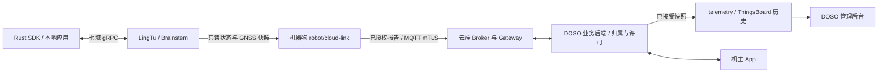

# 机器人云端管理

更新：2026-11-12。本次记录已确认的界面安排及后续交付建议，不代表新增部署或真机验证。当前部署与真机完成程度仍以 [PROGRESS.md](../PROGRESS.md) 为准。

## 管理什么

云端用于跨地点管理设备、保存授权范围内的历史、执行客户选择的规则并通知指定成员。SDK 封装机器人本地能力；云连接程序在许可有效时采集所需信息。云端不承担高频闭环控制，不默认上传 100Hz IMU、关节、点云或视频。

箭头描述现有技术职责，不代表真实机器狗已接通，也不授予 DOSO 员工查看客户位置和活动的权限。

| 管理内容 | 权威来源 | 已有能力 | 还需完成 |
| --- | --- | --- | --- |
| 身份与归属 | 设备登记、UUID v4、证书与业务归属表 | SDK 握手返回机器人 ID、机器人版本、固件版本；云端核对登记与归属 | 首台真实设备登记与安装验收 |
| 连接和最后联系 | Gateway 收到的合法 hello/report | `lastSeenAt`、`reachable`、报告新鲜度 | 管理台统一展示这些业务事实；平台活跃状态不能替代 |
| 机器人连接 IP | MQTT 接入端实际 socket peer，关联已认证设备身份 | 当前没有采集 | Broker 结构化连接事件、当前地址/时间/断开原因；不得从 Gateway HTTP 调用者推断 |
| 地理位置和轨迹 | GNSS 的 WGS84 fix 与源时间 | 机端可选位置、业务历史/App 轨迹；本轮补 TB 平面字段与 SDK 查询/订阅 | 实际部署、真实 GNSS 验收及位置类别授权 |
| 身体和控制状态 | Brainstem 只读状态 | 落地/站立/行走、控制来源、电机使能、严重电机故障 | 真机上报与面向客户的状态页 |
| 故障和采集异常 | 已报告的严重电机故障、读取错误 | `criticalMotorFault`、`sampleOk`、`readError`；本地 SDK 有来源覆盖的故障流 | 云端规则入口、发生/恢复记录及通知验收 |
| 活动异常 | 有时间的状态/位置与客户规则 | 原始事实和部分轨迹展示规则已有 | 客户启用围栏、离线时长、定位失效等规则；完整事件记录待实现 |
| 账号登录活动 | 账号认证与审计系统 | 与机器人 MQTT 连接是不同来源 | 11月12日明确云端保存可信登录IP与时间，账号可查本人记录；采集/保存/自查链需按实际代码验收 |

机器人连接 IP 表示接入端看到的网络出口，可能是 NAT、VPN 或代理。它不一定能用于 SSH，也不能代替 GNSS 位置。局域网地址、出口 IP、操作者登录 IP 分别命名和保存，不混成一个“登录 IP”。IP 变化本身只说明网络变化，不直接判定异常。

## 已确认的界面安排（2026-11-12）

客户主界面显示连接状态、最近联系时间，客户无需填写IP。账号安全页应能查看本人登录IP及登录时间，云端保存可信来源的记录，不把这类本人安全信息一律隐藏。机器人网络出口IP与账号登录IP分别处理；平台内部地址、内部连接身份和底层运行配置继续留在受限运维诊断。设备身份仍以机器人 ID 为准，位置使用 GNSS。

设备列表保持紧凑，显示设备名称、连接状态、最近联系和必要运行摘要；机器人 ID、机器人版本、固件版本在设备详情统一展示。连接状态、状态数据是否新鲜、用户是否开启云服务分别表达；最近未收到报告不能直接显示成物理关机。设备详情按状态、位置、事件与连接排布，连接编号和许可版本等执行参数不进入日常操作界面。

## 本轮实现

Rust SDK 的 `localization().location()` 和 `watch_location()` 通过 gRPC 读取机端已有 GNSS 快照，独立于 map-frame SLAM 位姿。订阅为 1Hz，返回定位可用、无 fix、过期、缺来源与无效状态，保留源时间和未知精度。不会开启云连接。[API 合同](D:/inovxio/brain/DOSO-SDK/docs/api/localization.md#地理位置)

[telemetry 投影](../cloud/telemetry/src/thingsboard.rs) 将已经被业务接受的可选位置展开，供平台地图、曲线和后续规则引用。没有新增采集字段、改变许可或开启设备出口。

| TB 字段 | 含义与使用条件 |
| --- | --- |
| `sampleOk` / `readError` | 本条读取是否成功及错误。读取失败不是物理关机 |
| `observedAt` / 遥测 `ts` | 机端本次状态读取时间，不是投递到 TB 的时间 |
| `locationAvailable` | 每条明确写入；本条含合法位置才为 true |
| `latitude` / `longitude` | WGS84 度数，仅本条有位置时写入 |
| `locationObservedAt` | GNSS 原始观察时间，与状态读取时间分别保留 |
| `locationFixType` | 原始 NMEA fix 代码 1–8，不推断传感器型号 |
| `locationAccuracyAvailable` | 每条明确写入；本条水平精度已知才为 true |
| `locationAccuracyM` | 实际已知精度，米；未知时省略 |

ThingsBoard 的 latest 对省略字段保留旧值。地图和规则必须核对 `sampleOk`、`locationAvailable`、相关 key 的时间与 `locationObservedAt`，过期后停止显示为当前位置；精度还需核对 `locationAccuracyAvailable`。历史位置可以保留，但应显示原始时间。没有新的报告时，旧的 true 也不会自己变成 false，不能省略时间检查。

本轮只补 SDK/机端读取与投影代码。未建立 ThingsBoard 告警规则，不把 REST 遥测保存成功当作规则引擎触发或机器人在线证明。当前全量 `sourceReport` 仍可能含位置，位置类别许可与人员访问隔离仍按 [合同](../CONTRACT.md#客户数据与告警责任) 补齐。

## 后续按这个顺序交付

1. 完成一台已授权设备的云开关：可信本地授权保存选择并唤起云连接服务；远程明确关闭时，保存关闭、结束连接，重启仍关闭；再次开启复用同一本地授权入口。现有 `Choice` 只有读取，进程关闭后仅写 true 不会启动服务，现有 reporting 关闭也只停采，因此这三个入口均需补齐，并按实际服务用户验证状态目录写入权限。普通断网和许可到期不改写成用户主动关闭。安装和用户许可是不同环节，默认关闭不变。
2. 将 ThingsBoard、管理前端及其数据库部署到独立云环境，替代当前开发机和临时 SSH 通道。发布位置投影 worker，验证现有业务 API、投递、历史读回及备份恢复；开发机关闭后云服务仍可运行。此项可与首台研发设备接线并行准备。
3. 接通设备列表与详情的真实业务数据：身份三项、最近联系、数据时间、运行摘要、位置可用性与已知故障。地图显示当前有效位置和带时间的历史，缺定位、过期和读取失败分别表达。未知值显示未知，旧值带时间。
4. 从 Broker 接入可信连接事件，绑定证书设备身份，保存排障所需接通/断开事实；出口 IP、内部连接身份与底层原因仅进入受限运维诊断，客户只获得业务状态与时间。不另开机端公网控制端口。
5. 沿 ThingsBoard 原有规则机制接通一条客户选择的规则，例如持续缺少新报告；验证发生、恢复、重复抑制、已读与指定接收人。再增加严重故障、定位失效和围栏，不另写通用规则引擎。关闭许可、归属变化及历史回放不得冒充新的实时设备事件。

数据类别与用途许可、客户设备访问隔离贯穿以上接线，在接入真实客户业务数据前落实。客户指定告警接收人；DOSO 人员默认查看范围沿用合同约束，不从当前实验租户的管理员权限推导生产权限。

SDK 并行完成配套机端服务交付、真实设备只读示例和 API 验收，沿用现有七域与权威状态/定位来源。验证数据时间、有效状态、订阅频率和错误含义，已通过的本地模拟记录与新增真机记录分别保存。

设备无云管理权，云端禁止远程运控，本地 SDK 保留操控，执行边界见 [正式契约](../CONTRACT.md#设备云端与本地-sdk-的权限边界2026-11-12-确认)。云端后续功能不得引入通用运动 RPC、方法透传或运控隧道。

规则阈值与接收人由客户决定。DOSO 提供能力、可选模板与平台运维；员工日常可见范围需要账号权限和审计落实。电机温度、电池电量、任务进度等只有真实来源接通后才进入云端规则，不从演示值补齐。

连接 IP 优先复用 Mosquitto 2.1.2 的[官方连接状态插件示例](https://github.com/eclipse-mosquitto/mosquitto/blob/99fa50f30e325609394c324c8ff71cfbbe95d8ab/plugins/examples/connection-state/mosquitto_connection_state.c)。其认证成功后的 `MOSQ_EVT_CONNECT` 可取得 `mosquitto_client_address()`、`mosquitto_client_username()` 和 `mosquitto_client_id()`；现有证书 listener 应核对 `require_certificate` 与 `use_identity_as_username` 的实际配置，用已认证证书 CN 关联设备。内部事件主题不能允许普通设备自行发布。这是后续接法，尚未安装插件或发布新的连接事件。[官方 API](https://github.com/eclipse-mosquitto/mosquitto/blob/99fa50f30e325609394c324c8ff71cfbbe95d8ab/include/mosquitto/broker.h)

## 当前验收范围

本轮测试、构建及部署证据记在 [TESTING.md](../TESTING.md)。真机 GNSS、公网 IP 采集、客户告警通知、人员隔离与完整断云尚未通过端到端验收。当前 ThingsBoard 和管理前端仍在开发机，独立云部署另行推进。

## 账号登录 IP 的实现与边界（2026-11-12）

App 源码已提供账号安全页的“登录记录”读取。认证完成后，`AuthContext` 调用 `account-sessions` 的 `capture_login`；服务端按当前 JWT 的 `session_id` 和用户身份，从 `auth.sessions` 读取认证服务保存的 `created_at`/`ip`，幂等写入 `account.login` 审计记录。账号安全页通过 `list_login_history` 读取当前账号自己的记录，最多 50 条，字段为 `id`、`loggedInAt`、`ipAddress` 和当前保留的 `method: null`。客户端不能传入或改写 IP，未知值显示“未记录”。

这部分源码和本地回归已完成，尚未部署迁移或新版 `account-sessions`，也未用真实账号完成线上登录 IP 读回。仓库中的 Nginx 模板已覆盖客户端自带的 `X-Forwarded-For`、注入 `Sb-Forwarded-For` 并将网关限制在 loopback；公网启用前仍需核对实际拓扑、限制绕过代理直达 Auth/Functions，并验证普通请求、伪造 XFF 和绕过入口三种结果。可信来源无法确认时保存 `null`，不猜测地点或 GeoIP。

账号登录 IP 与机器人 MQTT IP 分离：前者是认证服务在账号会话建立时记录的来源，只能由账号本人读取；后者是 Broker 认证设备后观察到的 socket peer，按设备证书身份记录，可能是 NAT/VPN/代理出口。MQTT IP 当前仍未采集，不能从 Gateway HTTP 调用方、账号登录 IP 或 GNSS 位置推导。两类 IP 不授予彼此的访问、SSH、设备寻址或远程控制权限。详见 [App API 合同](<C:/Users/99563/Documents/ChatGPT/New project/doso-app/docs/production/DOSO_ACCOUNT_LOGIN_IP_API.md>)。

